# quadrotor-gimbal-greybox-sysid

MATLAB grey-box system identification of a Pixhawk/PX4 quadrotor mounted on a 3-DOF gimbal rig: per-axis SISO roll/pitch/yaw models, plus a 3×3 MIMO model that tests whether cross-axis coupling matters. All models are validated on held-out chirp and sine runs.

## Overview

The quadrotor is fixed on a 3-DOF gimbal and driven with normalized torque commands (`tau_x`, `tau_y`, `tau_z`). The measured outputs are roll, pitch, yaw and their rates. Two questions are answered:

1. **SISO:** how well does a second-order model per axis, with an optional actuator lag, describe the rig, using one excited axis at a time?
2. **MIMO:** do cross-axis (off-diagonal) torque terms improve the fit when all three axes are excited at once?

**Short answer:** on held-out data the roll and pitch SISO models reach roughly 40–80% fit and the yaw model 20–47%. Adding cross-axis coupling gave no consistent improvement, so decoupled per-axis models are adequate for this rig.

## Repository contents

| File | Purpose |
|---|---|
| `roll_greybox_id.m`, `pitch_greybox_id.m`, `yaw_greybox_id.m` | Identify the SISO model of each axis on run 1, validate on run 2, save `*_id_results.mat` |
| `rollODE.m`, `pitchODE.m`, `yawODE.m` | State-space structure of each SISO model (`idgrey` function) |
| `validate_roll_model_run3.m`, `validate_pitch_model_run3.m`, `validate_yaw_model_run3.m` | Validate the SISO models on a third, independent run (fit plot + residuals) |
| `mimo_full_greybox_id.m` | Identify two MIMO models on 6 rotated multi-axis chirp runs: diagonal `B` (`mBothMIMO`) and full 3×3 `B` (`mBothMIMO_coupled`); validate on 6 repeat runs |
| `mimoFull_ODE.m` | State-space structure of the 3×3 MIMO model |
| `mimo_full_validate_roll.m` | Validate the MIMO models on roll-only runs (`tau_y = tau_z = 0`) |
| `compare_siso_vs_mimo.m` | Compare the three stacked SISO models with `mBothMIMO_coupled` on the MIMO validation runs |
| `images/` | Figures used in this README |

## Models

**SISO (per axis, e.g. roll).** The rig behaves like a damped pendulum, so the model includes a stiffness term `a0` and a damping term `a1` in addition to the control gain `b`:

$$\ddot\phi = -a_1\dot\phi - a_0\phi + \tau,\qquad \dot\tau = \frac{-\tau + b\,u}{T_m}$$

`Tm` is a first-order actuator (ESC + rotor) lag. It is used for roll and pitch; yaw has no lag (`USE_LAG = false`, `Tm` is not identifiable on that axis). Without the lag state, τ = b·u.

**MIMO (`mimoFull_ODE.m`, no actuator lag).** `b<axis><input>` is the effect of a torque input on an axis (for example `byx` is `tau_x` acting on pitch):

$$\ddot\phi = -a_{0r}\phi - a_{1r}\dot\phi + b_{xx}u_x + b_{xy}u_y + b_{xz}u_z$$
$$\ddot\theta = -a_{0p}\theta - a_{1p}\dot\theta + b_{yx}u_x + b_{yy}u_y + b_{yz}u_z$$
$$\ddot\psi = -a_{0y}\psi - a_{1y}\dot\psi + b_{zx}u_x + b_{zy}u_y + b_{zz}u_z$$

`mBothMIMO` fixes all off-diagonal `b` terms to zero, and `mBothMIMO_coupled` estimates all nine.

Inputs are normalized commands, so only the ratios `a1`, `a0`, `b` are identifiable (`b = ku/I`). Inertia and physical torque cannot be separated from this data alone.

## Requirements

- MATLAB with the **System Identification Toolbox** (`idgrey`, `greyest`, `compare`, `resid`) and the **Signal Processing Toolbox** (`butter`, `filtfilt`)
- Your own log files (not included, see below)

## Data format

CSV logs sampled at about 50 Hz (resampled to `Ts = 0.02 s` inside the scripts).

- **SISO logs** (one torque applied): `time, tau_x_cmd, roll_rad, pitch_rad, yaw_rad, rollspeed_rad_s, pwm1..pwm4`. The pitch and yaw logs use `tau_y_cmd` / `pitchspeed_rad_s` and `tau_z_cmd` / `yawspeed_rad_s`.
- **MIMO logs** (all torques applied): `time, tau_x_cmd, tau_y_cmd, tau_z_cmd, roll_rad, pitch_rad, yaw_rad, rollspeed_rad_s, pitchspeed_rad_s, yawspeed_rad_s, pwm1..pwm4`.

File names are set at the top of each script (`estFile`, `valFile`, `files`); edit them to match your logs.

## How to run

Put all `.m` files and your CSV logs in one folder, then run in this order.

1. **SISO:** for each axis, run `<axis>_greybox_id.m`, then `validate_<axis>_model_run3.m`. This creates `roll_id_results.mat`, `pitch_id_results.mat` and `yaw_id_results.mat`.
2. **MIMO:** run `mimo_full_greybox_id.m`. It reads the SISO results for starting values (default values are used if they are missing) and saves `mimo_full_models.mat`.
3. **Checks:** run `mimo_full_validate_roll.m` and `compare_siso_vs_mimo.m` (this one also needs the three `*_id_results.mat` files).

### Pre-processing

| Script group | Processing |
|---|---|
| SISO roll, pitch | Resample to 50 Hz, remove mean, no filtering |
| SISO yaw | Resample, 5 Hz zero-phase low-pass (4th-order Butterworth) on yaw and yaw rate, remove linear drift |
| MIMO | Resample, remove mean, zero-phase 0.25–2.4 Hz band-pass on all inputs and outputs |

Fit is the normalized RMSE fit in percent: `100 * (1 - ||y - y_sim|| / ||y - mean(y)||)`.

## Experiments

- **SISO:** a chirp on one axis (roughly 0.3–2 Hz). Run 1 is used for estimation, run 2 for validation, run 3 as an extra held-out run. Additional single-frequency sine runs (0.3, 0.8, 1.5 Hz) serve as validation.
- **MIMO:** the three torques are chirped at the same time, each in a different band: 0.3–0.8 Hz, 1.0–1.5 Hz and 1.8–2.3 Hz. The bands are rotated between `tau_x`, `tau_y`, `tau_z` over six runs so every input visits every band. Everything is repeated once: the first set of six runs is used for estimation, the second set for validation. Commands are normalized, amplitude ±0.05.

## Results

### SISO models

Identified parameters (2-output model `mBoth`, angle and rate fitted together):

| Axis | a1 [1/s] | a0 [1/s²] | b [rad/s²] | Tm [s] | Natural freq. | Damping ratio |
|---|---|---|---|---|---|---|
| Roll | 2.91 | 27.19 | 29.64 | 0.23 | 0.83 Hz | 0.28 |
| Pitch | 1.94 | 35.68 | 49.47 | 0.30 (at upper bound) | 0.95 Hz | 0.16 |
| Yaw | 2.15 | 1.20 | 6.53 | – (no lag) | 0.17 Hz | 0.98 |

Validation fit [%] of the angle-only models (`mRoll`, `mPitch`, `mYaw`):

| Axis | Chirp run 1 (estimation) | Chirp run 2 | Chirp run 3 | Sine 0.3 Hz | Sine 0.8 Hz | Sine 1.5 Hz |
|---|---|---|---|---|---|---|
| Roll | 65 | 58 | 70 | 47 | 71 | – |
| Pitch | 60 | 60 | 65 | 40 | 80 | – |
| Yaw | 65 | 33 | 47 | 44 | 20 | 40 |

A dash means no data was recorded.

### MIMO models

- **Coupling does not help.** `mBothMIMO_coupled` and `mBothMIMO` give essentially identical roll and pitch validation fits. The cross terms only change the yaw prediction, better in some runs and worse in others, with no consistent gain.
- **The fit depends on the excitation band of the axis.** Roll and pitch are predicted reasonably only when their own torque sweeps 0.3–0.8 Hz, near the rig's resonance. Above resonance the response shrinks and falls into the noise:

  | Own torque band | Roll fit [%] | Pitch fit [%] |
  |---|---|---|
  | 0.3–0.8 Hz | 50–55 | 58–62 |
  | 1.0–1.5 Hz | 12–18 | 17–19 |
  | 1.8–2.3 Hz | about 0 | about 0 |

- **Off-axis fits near 0% are not model failures.** Off-axis angles barely move in single-axis runs, so there is little signal to predict.
- **Conclusion:** cross-axis coupling is not supported by this data. Decoupled per-axis SISO models are adequate.

## Figures

### Roll model validation on held-out runs

| Sine 0.3 Hz (fit 46.9%) | Sine 0.8 Hz (fit 71.5%) | Chirp run 3 (fit 69.5%) |
|---|---|---|
| 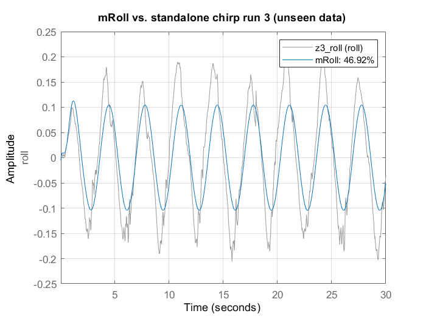 | 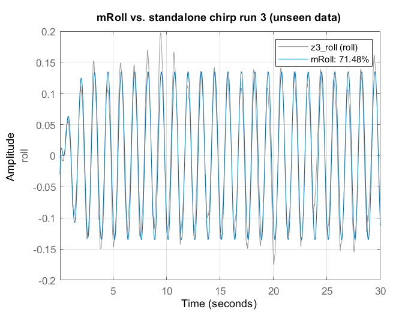 | 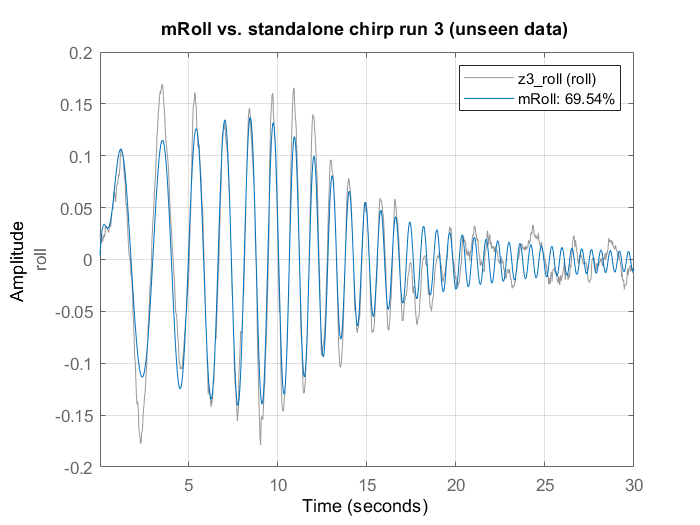 |

The plot title in `validate_roll_model_run3.m` is hard-coded as "standalone chirp run 3"; change the `title(...)` line when you validate on a sine log.

### Roll frequency response

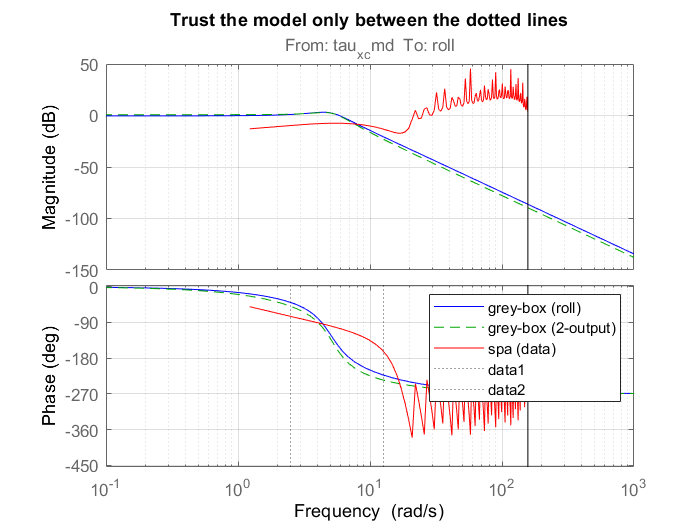

The identified grey-box models (blue: angle only, green dashed: angle and rate) follow the non-parametric estimate from the data (red, `spa`) inside the excited band, which is marked by the dotted lines. Outside that band the data estimate is noise, so the model should only be trusted between the dotted lines.

### Residual analysis

Residual autocorrelation (left) and cross-correlation with the input (right), with the confidence region shaded. Bars outside the shaded region mean unmodelled dynamics remain, such as nonlinearity or the amplitude mismatch visible in the sine plots above.

Roll model:

| | |
|---|---|
| 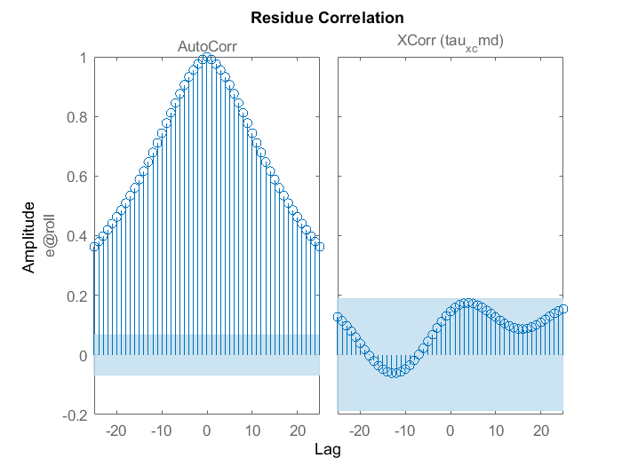 | 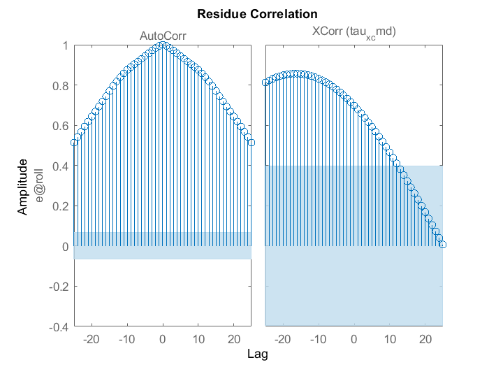 |
| 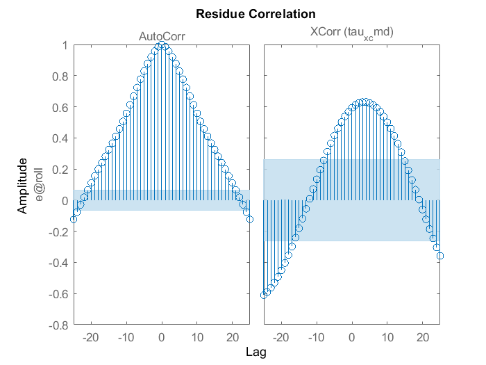 | 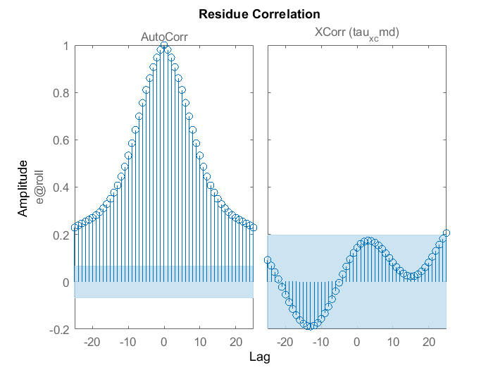 |

Roll-rate model residuals:

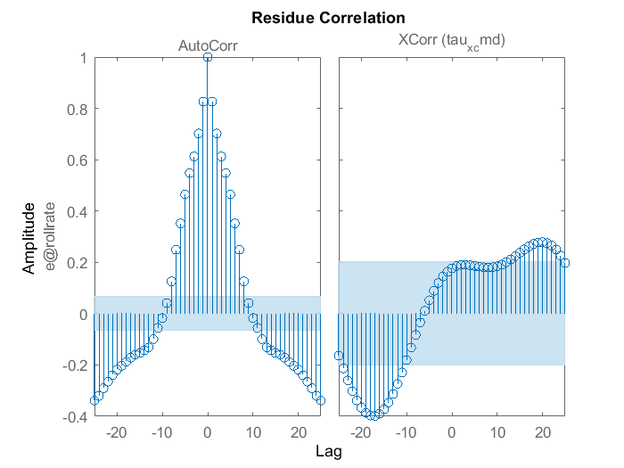

Early MIMO exploration (diagonal vs roll→yaw coupling)

These figures come from an earlier exploratory 3×3 fit (`mimo_greybox_id.m` and `mimoODE.m`, not part of the scripts above). It compared a diagonal model (`M0`), a model with roll→yaw torque coupling `bzx` (`M1`), and a model with roll→yaw sensor leakage `cyr` (`M3`). Models with the suffix `a` were trained on run 1 and tested on run 2.

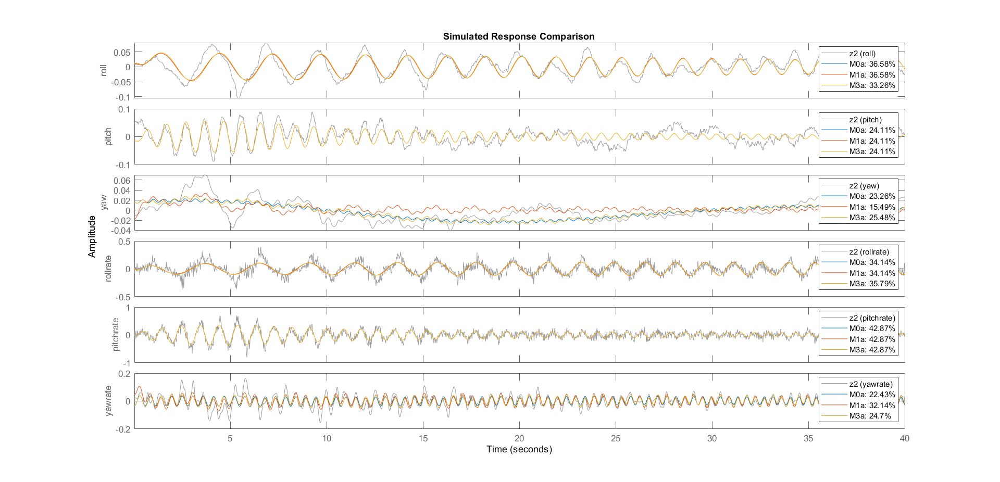

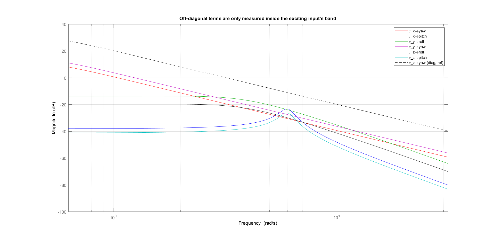

Off-diagonal terms are only observed inside the band of the exciting input; the dashed line is the diagonal `tau_z → yaw` term for reference.

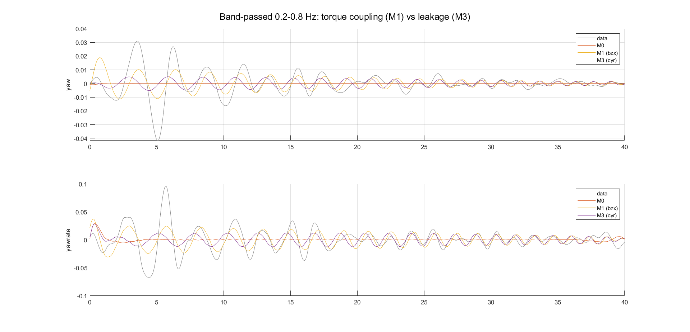

## Limitations

- **Moderate fits.** Held-out fits are 40–80% for roll and pitch and 20–47% for yaw. Residual correlation shows unmodelled dynamics remain.
- **Pitch `Tm` sits at its upper bound** (0.30 s), so treat it as a constrained value, not an estimate.
- **Weak MIMO excitation at high frequency.** The response of an axis above its resonance is small at ±0.05 command amplitude, so cross terms are poorly determined there. A longer, larger-amplitude experiment in the 1.0–2.3 Hz bands would be needed to test coupling more strictly.
- **Normalized commands.** Only the ratios `a1`, `a0`, `b` are identified; inertia and torque constants need independent measurements.
- **One rig, one set of logs.** The results apply to this gimbal setup and may not carry over to free flight, where the rig stiffness and friction terms disappear.

## Author

Ehsan Zakeri, Aerospace Engineering, K. N. Toosi University of Technology (KNTU).

